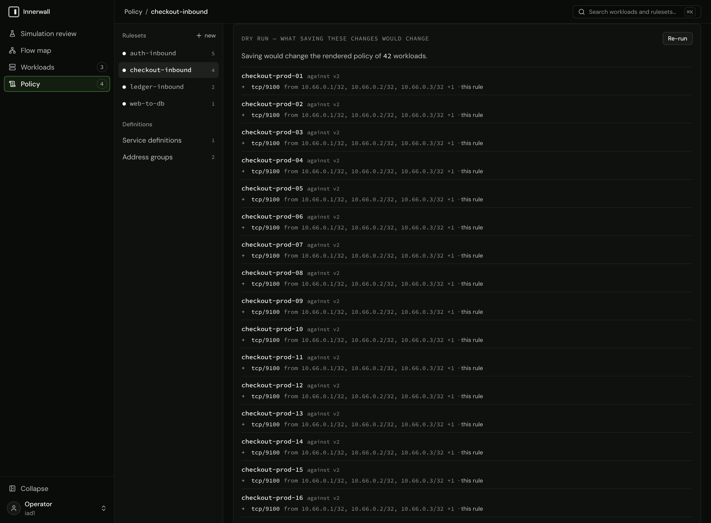

# Writing the first ruleset

A ruleset says who may connect to one protected tier, and on what. This guide writes one in the console's policy editor (or on the command line), checks it with a dry run, and saves it. The model it rests on (the scope is the destination, one ruleset per tier) is in [docs/policy.md](../policy.md); read its first section before writing a ruleset.

## Before you start

- **The tier is labeled.** The ruleset's scope selects the tier by label, so the workloads you protect carry a label that selects exactly them ([labeling strategy](labeling.md)).
- **You know what reaches the tier today.** While the tier is in visibility, the flow map and each workload's **Inbound flows** tab show the real connections reaching it: the peers and services the rules must admit. Nothing is dropped in visibility, so writing the ruleset changes nothing on the hosts until you move them to simulation.

## Write it

<!-- steps -->
1. **Create the ruleset.** In **Policy**, choose **new** beside the ruleset list (**New ruleset** on a fresh install), give it a name and a description, and create it. Name it for the tier it protects (`db-inbound`): the name is what the review and the fleet show.
2. **Set the scope.** Add the requirements that select the tier (`role=db`, or `role=db env=prod`). The scope card shows how many workloads the scope matches as you edit it. That count is every workload each rule below will reach; if it holds more than the tier, narrow the scope before writing rules.
3. **Add a rule per peer and service set.** Choose **Add rule**. In the peer input, write who may connect, and in the services, on what. A tier that admits several peers on different services holds several rules. A service or an address group a rule names must exist when the rule is saved ([services and address groups](#services-and-address-groups)); a save that names a missing one is refused, and the finding offers to create it without leaving the row.
4. **Run the dry run.** Choose **Dry run**. It submits every ruleset as read, with your unsaved edits in place, and lists each workload whose rendered policy would change and the rules it would gain, lose, or see changed. It never writes. If a workload outside the tier is listed, the scope is too broad or the rule is in the wrong ruleset.
5. **Save.** The row's save applies at once and says how many workloads it applies to. When the scope and a rule are both edited, the row's save is **Save rule and scope**: it writes the two together as one ruleset write, which is exactly the combination the dry run previewed.



## The peer input

The peer input reads one of three forms, in this order:

| You write | It is read as | Example |
|---|---|---|
| Text containing `=` | A workload selector: `key=value` requirements separated by spaces, a key's values by `\|`. Resolves to the current addresses of the workloads it matches, and follows them as they change. | `role=api env=prod`, `role=web\|api` |
| Text shaped like an address | A CIDR. | `10.20.0.0/16`, `fd00::/8` |
| Anything else | The name of an address group. | `corp` |

The form is decided by shape, not by whether the text is valid, so a mistyped address is still read as an address: `10.0.0.999/8` is refused on save or dry run as `address is not a valid CIDR (10.0.0.999/8)`, and an unknown name as `rule references an address group that does not exist (corp)`. A single host is a CIDR with its prefix length (`10.20.0.7/32`); an address without one is refused the same way.

> [!TIP]
> Admit the operator's own path now, while you are writing rules. A workload that no rule admits your management traffic to (SSH from a bastion, an administration network) will have that traffic dropped once it is enforced. A CIDR or address-group peer for the management network, on `tcp/22` or whatever you manage the host with, belongs in the tier's ruleset or in an estate-wide one ([promotion and enforcement](promotion-and-enforcement.md#before-you-promote-admit-your-management-path)).

## Services and address groups

A rule can state its protocols and ports inline (`tcp/5432`) or reference a *service* by name (`postgres`), and can name an *address group* (`corp`) as a peer: a named set of CIDRs for sources that are not managed workloads. Both are defined once and referenced by any number of rules; changing one changes what every rule referencing it admits, at once.

In the console they are listed under **Definitions** in the policy rail: **Service definitions** and **Address groups**. Each list shows what every definition expands to (`postgres` is `tcp/5432`) and which rules reference it, each a link to its ruleset; a reference in a rule shows the same expansion on hover. **New service** and **New address group** create one, and **Edit** changes one, under the same admission as the command line: a service's entries are typed as the services input reads them (`tcp/5432`, `udp/53`, `tcp/6000-6010`, `icmp`; the command line's `tcp:5432` reads too), an address group's members as CIDRs, several pasted at once. An edit is conditioned on the version the list read, like every other write.

When a rule's save names a service or an address group that does not exist, the finding (`rule references a service that does not exist (postgres)`) carries **Create service postgres…**, which opens the same form with the name filled in. Creating it keeps the row as you left it; save the rule again. A definition created this way changes no workload's policy until a rule that references it is saved.

## Findings

Every save and every dry run is admitted in full on the control plane, and every finding is reported in one pass: on the ruleset, on each rule, on each service entry. A refused save writes nothing. Each finding is placed on the field it concerns; fix them all and save again. Typical findings: a label outside the grammar ([labeling strategy](labeling.md#the-grammar)), a CIDR that does not parse, an address group or service that does not exist, a rule with no peers or no services (it would admit nothing), a port range outside `start <= end <= 65535`, or ports listed for `icmp`.

A save conditioned on a ruleset version that has moved since you read it (someone else saved meanwhile) is refused with the current version. Read the ruleset again and redo the edit; nothing was overwritten.

## On the command line

The same ruleset, written as a document and created with `innerwall ruleset create`. The command line goes through the same admission and the same render as the console:

```json title="db-inbound.json"
{
  "name": "db-inbound",
  "description": "who may reach the databases",
  "scope": {"role": ["db"]},
  "rules": [
    {"direction": "inbound",
     "peers": [{"workloads": {"role": ["api"]}}],
     "services": ["postgres"]},
    {"direction": "inbound",
     "peers": [{"address_group": "corp"}],
     "entries": [{"protocol": "tcp", "ports": ["22"]}]}
  ]
}
```

```sh
innerwall service create --name postgres --entry tcp:5432
innerwall address-group create --name corp --cidr 10.0.0.0/8
innerwall ruleset create -f db-inbound.json
```

The two definitions the rules name are created first, as the console creates them from the lists or from the rule's findings. The command line has no dry run of its own; the console's dry run reads the same stored rulesets. The document's fields are in the [command-line reference](../reference/innerwall-cli.md#ruleset).

## Next

Move the tier's workloads to simulation and read what the ruleset would drop: [reading a simulation review](simulation-review.md).
