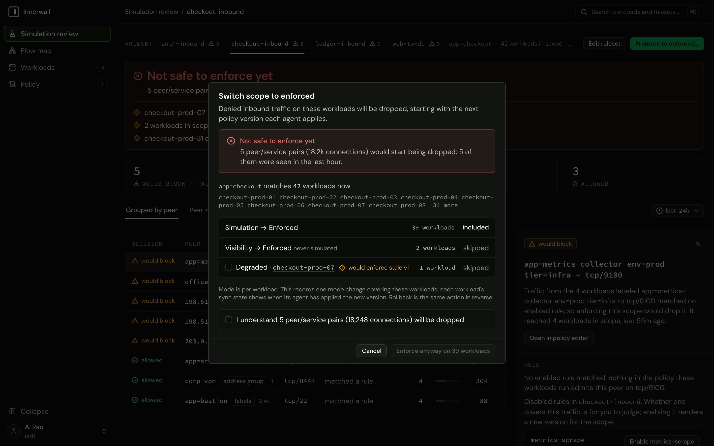

# Promotion and enforcement

Promotion moves workloads from simulation to enforced: from then on, a new inbound connection no rule admits is dropped. This guide covers what to check before promoting, the promote flow, what enforcement looks like on the host, how it behaves when the control plane is away, and the local kill switch.

## Before you promote: admit your management path

> [!CAUTION]
> Enforcement drops every new inbound connection no rule admits, and that includes yours. A workload that no ruleset's scope matches holds no rules at all: in simulation every inbound connection to it is would-block, the operator's own SSH or management traffic included, and enforced, every one is dropped. Before promoting, make sure a rule admits the path you manage the host by (a CIDR or address-group peer for your administration network or bastion, on the port you use), and that it appears as `allowed`, not would-block, in the review.

The agent's own connection to the control plane is never at risk: the agent only dials out, and the return traffic of a connection the host opened is accepted before any rule. Outbound traffic is not filtered at all in this version (ADR-0010).

## The promote flow

Promotion starts from a ruleset's simulation review ([reading a simulation review](simulation-review.md)):

<!-- steps -->
1. **Read the verdict.** **Safe to enforce** means every observed inbound connection on the simulating workloads matched an enabled rule and nothing else failed. **Not safe to enforce yet** lists each failing condition.
2. **Open the promote dialog.** **Promote to enforced…** opens **Switch scope to enforced**, which restates the verdict and, when it is not safe, the cost: how many peer/service pairs and connections would be dropped, and whether the evidence for the range is incomplete. Workloads in scope that are still in visibility are listed and skipped (they never simulated); a degraded workload is skipped unless you include it, since it would enforce a stale version.
3. **Acknowledge, if the verdict is not safe.** Enforcing past an unsafe verdict takes an explicit acknowledgment of exactly that cost ("I understand … will be dropped", with "and that the evidence for this range is incomplete" when it is). Without it, nothing is enforced.
4. **Enforce.** The dialog records one mode change covering the listed workloads. Each workload's sync state shows when its agent has applied the new version.



**Rolling back is the same action in reverse:** change the workloads' mode back to simulation (the fleet's **Change mode for selected…**, the **change…** beside the mode on the workload page, or `innerwall workload set-mode <workload-id> simulation`). Nothing is dropped from the moment the agent applies it.

> [!WARNING]
> The review's verdict and its acknowledgment live in the promote flow only. The fleet's **Change mode for selected…**, the **change…** beside the mode on the workload page, `innerwall workload set-mode`, and `POST /api/v1/mode-changes` set any mode, enforced included, in one step, with no verdict and no acknowledgment, even for a workload with no simulation evidence at all. Promote through the review; use mode changes to roll back or to move workloads into simulation. A server-side evidence guard is on the [roadmap](../../ROADMAP.md).

## What enforcement looks like on the host

The agent owns one nftables table, `inet innerwall`, and touches nothing outside it (ADR-0003, ADR-0020). Every policy it receives is written durably to its state directory first, then applied to the kernel as one transaction, and acknowledged as applied only when both succeeded. A full apply replaces the table as a unit; a change that only moves a rule's peers updates that rule's sets inside the table, in one transaction. No mixture of versions is ever installed.

In outline, the table an enforced workload holds:

```text title="inet innerwall (outline)"
table inet innerwall {
	set r_<rule-id>_v4 { type ipv4_addr; flags interval; elements = { <peer CIDRs> } }
	set r_<rule-id>_v6 { type ipv6_addr; flags interval; elements = { <peer CIDRs> } }
	chain inbound {
		type filter hook input priority filter + 10; policy accept;
		iif "lo" accept
		ct state established,related accept
		ip saddr @r_<rule-id>_v4 tcp dport { 5432 } ct state untracked accept
		ip saddr @r_<rule-id>_v4 tcp dport { 5432 } ct mark set (ct mark & 0x0000ffff) | <rule mark> accept
		ip6 saddr @r_<rule-id>_v6 tcp dport { 5432 } ct state untracked accept
		ip6 saddr @r_<rule-id>_v6 tcp dport { 5432 } ct mark set (ct mark & 0x0000ffff) | <rule mark> accept
		log prefix "innerwall " group 200 drop
	}
}
```

- **Loopback and established traffic** are accepted before any rule, so a connection that was open before enforcement keeps working, and so does the return traffic of every connection the host opens.
- **Each rule** has two interval sets of peer addresses, one per address family, and matches its protocol and ports. Workload peers resolve to the addresses their workloads report and follow them as they change.
- **Untracked traffic.** Each rule's accept is paired with one that admits the same traffic when the kernel does not track it, without marking it. The kernel never tracks IPv6 neighbor discovery, and a host's own `notrack` rules can exempt more; a mark write cannot complete for such a packet, so without the pair it would fall through to the terminal rule. Admitted untracked traffic has no connection to attribute and leaves no flow record.
- **Attribution.** An admitted connection's connection-tracking mark carries the rule that admitted it, in bits 16 to 31 (mask `0xffff0000`). The low sixteen bits are left exactly as found, so a host tool that marks connections there keeps working; one that uses the high bits conflicts with the agent. `nft list` prints the write as `ct mark & 0x000Nffff | 0x000N0000`, its own reading of the kernel's mask-and-xor form; it is the same write as the rendered `(ct mark & 0x0000ffff) | 0x000N0000`, because the or sets the extra bits the printed mask keeps.
- **The terminal rule** logs every new inbound connection no rule admitted to netlink log group 200 and, enforced, drops it. In simulation the same rule accepts instead (and marks the connection as would-block); in visibility the table holds a single `observe` chain that engages connection tracking and accepts everything.
- **The host's own firewall** is untouched. The chain runs at input priority `filter + 10`, after the host's own filter chains, and a packet must be accepted by both.

Inspect it with `sudo nft list table inet innerwall`. The kernel prints its own formatting of the same rules.

## Fail static

An agent fails static: never open, never closed (ADR-0011).

- **The control plane goes away:** nothing changes on any host. Enforcement continues from the installed table; flow windows are held in a bounded buffer and delivered when the control plane returns.
- **The agent restarts or the host reboots:** the daemon re-applies its last acknowledged policy from disk before it dials anything, so the host is enforcing before it is connected. The persisted version and mode survive.
- **The control plane returns:** agents reconnect by themselves, with exponential backoff and full jitter (at most five minutes between attempts), and each new stream begins with a snapshot of the workload's current policy. No operator action is needed.
- **The daemon stops:** the kernel rules stay in place, still enforcing. Only the kill switch removes them.

## The kill switch

Root on the host can remove enforcement at any time, without the control plane:

```sh
sudo innerwall-agent down
```

It deletes the owned table and nothing else, and says what it did and what happens next:

```text
ENFORCEMENT REMOVED FROM THIS HOST.
The owned nftables table "innerwall" was deleted. This agent no longer evaluates or drops any inbound connection; every other firewall table on the host is untouched.
```

The persisted policy stays on disk, so the removal lasts only until the agent next applies a policy:

- **A running daemon** reinstalls the table on its next policy update, and on any new sync stream, because every stream begins with a snapshot. **Resend snapshot** on the workload (or `innerwall workload resend-snapshot`) is therefore the way to restore enforcement from the console.
- **A restarted daemon** reinstalls it on start.
- **To keep enforcement off**, stop the daemon too (and keep it from starting at boot).

While the table is gone and the daemon runs, the daemon reports it on its next heartbeat (every 30 seconds). The workload then reads **Enforcement removed on host** in the Workloads table and on its page, the fleet's `removed` filter selects it, and the time without the table is recorded as a `table_removed` evidence gap, because nothing is observed while it is gone.

> [!NOTE]
> The removal is reported only by a running daemon. A host where `down` is followed by stopping the daemon before its next heartbeat is never reported as enforcement removed: its stream ends, and the workload reads Offline.

## Next

Keep the workload's credential healthy: [credential lifecycle](credential-lifecycle.md). Each state the console shows is in [states](../reference/states.md).
