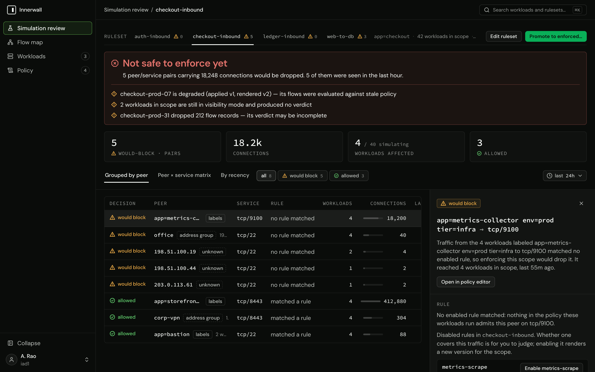
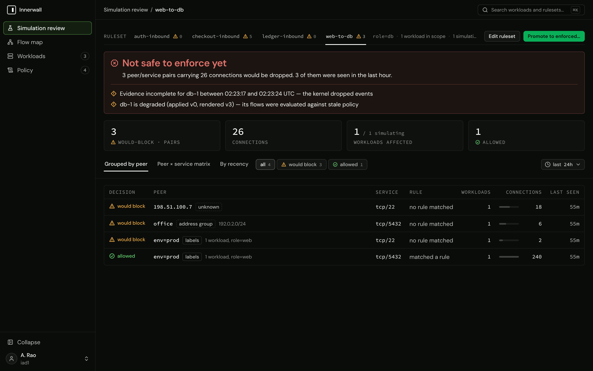

# Reading a simulation review

The simulation review is where a ruleset is judged before it is enforced: the real, recent connections that enforcing it would drop, the evidence behind that list, and a verdict on whether enforcing is safe. This guide covers how simulation produces that evidence, how to read the verdict, and what to do about each kind of finding. The decision behind the workflow is ADR-0001.

## What simulation records

A workload in simulation holds exactly the ruleset it would hold enforced, with one difference: the terminal rule, which meets every new inbound connection no rule admitted, accepts and records instead of dropping (ADR-0020). So every connection is still delivered, and each one is recorded with a decision:

| Mode | A connection a rule admits | A connection no rule admits |
|---|---|---|
| Visibility | `observed` (no rules are installed) | `observed` |
| Simulation | `allowed` | `would_block` |
| Enforced | `allowed` | `blocked`, and dropped |

The review lists the `would_block` traffic of the workloads its ruleset's scope matches, over the range you choose (the last hour to the last 30 days, 24 hours by default).

**Evidence starts when the workload enters simulation.** Traffic a workload received in visibility was recorded as `observed`, and a stored flow is never rewritten (ADR-0019), so that traffic never appears as would-block, and nothing is evaluated retroactively. After moving a tier to simulation, the review fills as new connections arrive: a peer that connects once a day needs a day of simulation before the review can show it. The review says how much observation stands behind its verdict ("Observed for 6h …; a peer that connects less often than that has not been seen"). Choose a range that covers your slowest regular traffic (nightly jobs, weekly reports) and let simulation run that long.

The range is a range, not a starting point: it also counts any `would_block` traffic left from an earlier stint in simulation that falls inside it.

## The verdict

The review's headline is one of:

- **Safe to enforce.** Every observed inbound connection on the simulating workloads matched an enabled rule, and nothing else fails.
- **Not safe to enforce yet.** At least one condition fails. Each failing condition is listed beneath it.
- **No workload in scope**, or **Nothing is simulating in this scope**: there is no simulated verdict to review.



The conditions, each of which fails the verdict on its own:

| Condition | What it reads like | What to do |
|---|---|---|
| Would-block traffic | `N peer/service pairs would be dropped` | Decide each pair: admit it, or accept that enforcement drops it (below). |
| Evidence gaps | `Evidence incomplete for db-1 between 13:02 and 13:04 UTC — the agent was not reporting` | Find out why the evidence is missing ([evidence gaps](#evidence-gaps)). |
| A workload offline | `db-1 is offline (last seen 2h ago) — nothing it saw since reaches this review` | Bring the agent back, or exclude it from the decision deliberately. A workload whose control channel is reconnecting while its flow reports still arrive is counted as offline here. |
| A workload degraded or pending | `… has not applied its latest policy (applied v3, rendered v4)` | Its flows were evaluated against a policy other than the one you are judging; wait for it to apply, or find why it failed ([states](../reference/states.md#sync-states)). |
| A workload still in visibility | `N workloads in scope are still in visibility mode and produced no verdict` | Move them to simulation, or accept that the review says nothing about them. |

A workload that dropped flow records is noted beside the verdict: its verdict may be incomplete.

## Would-block traffic

The review lists the traffic three ways: **Grouped by peer**, as a **Peer × service matrix**, and **By recency**, each with the decision, the rule that matched (or none), the workloads that saw it, the connections, and when it was last seen. Each pair is one of three things:

- **Traffic the ruleset forgot.** A real dependency with no rule: add the rule (the pair's detail drawer has **Open in policy editor**, which carries its peers and services into the editor), dry-run it, and save. New connections are then recorded as `allowed`; the already-recorded would-block windows stay in the range until it moves past them.
- **Traffic that should stop.** Something reaching the tier that should not. Leave it unadmitted; enforcing drops it, and the review asks you to acknowledge exactly that.
- **Traffic from the network itself.** On a real network a host receives inbound traffic nobody wrote a service for: LAN discovery broadcasts and multicast (mDNS, SSDP), and on a host with IPv6, link-local ICMPv6 from `fe80::/10` (neighbor discovery and router messages). Simulation records these like any other unadmitted traffic, which is the product doing its job: enforcement would drop them too. Decide each one. A host that needs IPv6 neighbors needs link-local ICMPv6 admitted; discovery chatter is usually safe to let enforcement drop.

To admit network traffic, name its sources once as an address group and admit the group where it is needed:

```sh
innerwall address-group create --name ipv6-link-local --cidr fe80::/10
```

Then, in the tier's ruleset (or one scoped to every workload that needs it), add a rule whose peer is `ipv6-link-local` and whose service is `icmp`. Address groups are created on the command line or the API; the console names them in a rule's peer input.

**Mixed pairs.** Where one source and destination pair carried traffic under more than one decision (some admitted, some would-block), the flow map's edge, the matrix's cell, and the review's matrix show the most severe one (blocked, then would-block, then allowed, then observed), and the number is the connections under that decision only. The admitted volume of the pair is in its detail drawer, which lists every decision.

## Evidence gaps

An evidence gap is an interval in which a workload's observation is known to be incomplete: the kernel dropped events, a flow source was down, a window was full or refused, the owned table was removed, or the agent was not reporting at all. A gap that intersects the review's range fails the verdict by itself, because traffic in it may have gone unseen: the verdict reads "No observed traffic would be dropped, but evidence is missing from part of this range". Every kind and what to do about it is in [states](../reference/states.md#evidence-gaps).



> [!NOTE]
> A gap the control plane derives because the agent went silent (`agent_silent`) is written when the agent reports again. While an agent is still down, the review shows the workload offline instead, and the gap appears once it returns.

## Promoting

When the verdict is safe, **Promote to enforced…** opens the promote dialog with the verdict restated. When it is not safe, the dialog restates the cost (how many peer/service pairs and connections would be dropped, and whether the evidence is incomplete) and enforcing takes an explicit acknowledgment of exactly that. The acknowledgment is the deliberate override ADR-0001 records: promotion past evidence that does not support it is possible, never silent. What promotion does on the host, and how to roll it back, is in [promotion and enforcement](promotion-and-enforcement.md).

> [!NOTE]
> Fleet health does not yet tell a workload that receives no inbound traffic from one whose observation is broken without any gap being recorded: both show no flows. A tier whose review shows no traffic at all deserves a look at each workload's **Inbound flows** tab and last flow report before it is promoted.
