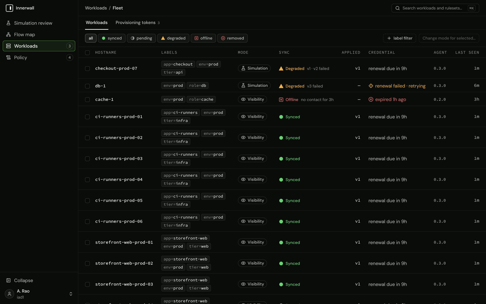

# Workload states

Every word the console and the API use for a workload's condition, what each one means, and what to do about it. The workload's page shows its exceptional states as chips beside the tabs, critical first, each opening its explanation; the Workloads table shows its sync state, mode, and agent.

## Modes

A workload's mode decides what its table does with a new inbound connection that no rule admits (ADR-0001, ADR-0020). Every workload starts in visibility.

| Mode | API value | The table | Such a connection is recorded as |
|---|---|---|---|
| Visibility | `visibility` | One `observe` chain that engages connection tracking and accepts everything; no rules installed | `observed` |
| Simulation | `simulation` | The exact enforced ruleset, with a terminal rule that accepts and records | `would_block` |
| Enforced | `enforced` | The ruleset, with a terminal rule that logs and drops | `blocked` |

A connection a rule admits is recorded as `allowed` in simulation and enforced.

## Sync states

A workload's sync state is its convergence with its latest rendered policy, as its sync stream reports it. The API's `sync.state` is one of four values; the console draws each with a glyph as well as a word, so color is never the only signal.

| State | Glyph | Meaning | What to do |
|---|---|---|---|
| Synced | solid disc | The agent acknowledged applying the latest rendered version. | Nothing. |
| Pending | half-filled ring | A stream is open and the agent has not yet acknowledged the latest version: it was just rendered, or the stream just began. | Wait; it clears when the agent applies. If it stays, read the agent's journal. |
| Degraded | solid triangle | The agent reported that applying the latest version failed. The host keeps the policy it had before. | Read the failure on the workload page (`innerwall workload status` prints the sync error), fix its cause on the host, then **Resend snapshot**. |
| Offline | × in a square | The control plane recorded the workload's sync stream ending, or the agent has never connected. | Check the host and the agent. Enforcement on the host is unchanged (fail static). |

The note beside the state says more: the version not yet applied, when an apply failed, or how long there has been no contact ("no contact for 2h", "never connected").

**Reconnecting.** A workload whose sync stream is down while its flow reports still arrive reads **Reconnecting** instead of Offline: the control channel is reconnecting, but the agent is running and reporting ("control channel down · flow reports arriving"). Flow reports count as live when one arrived within two flow windows (two minutes by default) of the read; the API's `health.telemetry_live`. In the API it is still `sync.state` `offline`, and the simulation review counts the workload as offline.

**Enforcement removed on host.** A workload whose agent reports that its owned table is gone from the kernel (the local kill switch, or anything else that deleted it) reads **Enforcement removed on host**, whatever its sync state: nothing on the host is enforced or observed. The API's `health.owned_table.state` is `absent`. The fleet's `removed` filter selects these workloads, they rank with the degraded ones at the top of the fleet's order, and `GET /api/v1/workloads/counts` counts them in `removed` and in no sync state. The stored sync state still records the version the agent acknowledged, so the sync-state filters (the fleet's state chips, `GET /api/v1/workloads?sync_state=…`) still match a removed workload by that state: a kill-switched host whose last acknowledgment was synced is listed under `synced`, where its row reads Enforcement removed on host, but is not in the `synced` count. To restore the table, **Resend snapshot** ([the kill switch](../guides/promotion-and-enforcement.md#the-kill-switch)).

## Credential

| API `health.credential.state` | Console | Meaning |
|---|---|---|
| `renews` | "renewal due in 9h", then "renewal due now" | Valid, and the last renewal that was due succeeded. |
| `renewal-failed` | "renewal failed · retrying" | Valid, but the agent's last renewal attempt failed; the error is on the workload page. |
| `expired` | "expired 5h ago", and the **Credential expired** chip | Past its expiry. It may still renew, and do nothing else, within the control plane's renewal grace (72 hours unless set otherwise); beyond it the workload must be re-enrolled. The console does not yet say which of the two applies: read the expiry against the grace. |

After a renewal made with an already expired credential, the console shows "renewed 3h late" beside the countdown, from `health.credential.last_late_renewal`. What each case means for the host is in [credential lifecycle](../guides/credential-lifecycle.md).

## Other chips

| Chip | Meaning | What to do |
|---|---|---|
| **Clock skew** | A flow report showed the agent's clock off from the control plane's by more than two flow windows. The workload's windows are stamped with the wrong time by about that much. | Re-sync the host's clock ([troubleshooting](../troubleshooting.md#flow-times-are-wrong-the-agents-clock-has-drifted)). |
| **Evidence gap** | The workload has an evidence gap in the range shown (below). | Read its kind. |

## Evidence gaps

An evidence gap is an interval in which a workload's observation is known to be incomplete (ADR-0019). Gaps are shown on the workload's Overview ("the agent was not reporting between 13:02 and 13:04 UTC"), on the flow map, and in the simulation review, where a gap intersecting the review's range fails the verdict on its own. They are read with `GET /api/v1/flows/gaps` and `innerwall flows gaps`.

| Kind | Console text | What happened | What to do |
|---|---|---|---|
| `source_overrun` | the kernel dropped events | A flow source's socket buffer was full and the kernel dropped connection events. | Raise `--flow-netlink-buffer` on a host with bursts of new connections. |
| `source_restart` | a flow source was down | A flow source failed and was down until it subscribed again. | Read the agent's journal for the failure. |
| `buffer_overflow` | the agent dropped buffered windows | The control plane was unreachable long enough that the agent's buffer of closed windows overflowed, and the oldest were dropped. | Expected after a long outage; raise `--flow-buffer-records` to ride out longer ones. |
| `dump_truncated` | the connection table was cut at its bound | At subscribe, the connection table held more entries than `--flow-dump-max`. | Raise `--flow-dump-max` on a host with very many connections. |
| `window_overflow` | the agent's flow window was full | An open window held `--flow-window-keys` distinct keys, and observations for new keys were dropped until it closed. | Raise `--flow-window-keys` on a host with very many distinct peers. |
| `window_rejected` | the control plane refused a malformed window | The control plane refused a closed window as malformed, and the agent dropped it rather than retry it. | Read the agent's journal (`flow window refused by the control plane as malformed`) and the control plane's log for the window it refused. |
| `table_removed` | enforcement was removed on the host, so nothing was observed | The owned table was gone from the kernel, so nothing was enforced, observed, or classified. Reported with each window while it lasts. | Restore the table ([the kill switch](../guides/promotion-and-enforcement.md#the-kill-switch)). |
| `agent_silent` | the agent was not reporting | No flow report arrived from the agent for longer than two flow windows, no window delivered afterwards covered the interval, and no heartbeat showed one agent process running through it: the agent process was down, or it lost what it would have reported. | Find out why the agent was down: the host's journal around the interval. |

`agent_silent` is the one kind the control plane derives itself, from the instants it received consecutive reports, so it needs no cooperation from the agent and the agent cannot claim it. It is written when the agent reports again: while the silence lasts, the workload shows it as offline (or as a live control channel with no flow reports), and the stored gap appears once the agent returns. Windows that arrive late because the agent buffered them through an outage cover the time they were held back, so an outage the agent rode out, or a quick restart, records no gap. A quiet workload records none either: the agent sends no report for a window in which it saw nothing, and each heartbeat's uptime shows the control plane that the process which sent the last report is the one sending the next. Every other kind is reported by the agent, which knows it lost evidence; its source is `conntrack` or `nflog` where one source lost it, and null otherwise.

## Flow counts

A stored flow window aggregates connections by peer, service, decision, and rule (ADR-0009). Its counters mean:

- **Connections** (`connection_count`): connections opened, or found live when the flow source subscribed, in the window. A connection that predates the source's subscription (at agent start, or after the source restarted) is counted once, first seen at the subscription.
- **First seen** (`first_seen`): the first time the agent saw the key in the window, which is not necessarily when the connection opened.
- **Bytes**: counted only when the host has per-connection accounting enabled (`net.netfilter.nf_conntrack_acct=1`); zero otherwise.

## Resend snapshot

**Resend snapshot** on a workload (`POST /api/v1/workloads/{id}/resend-snapshot`, `innerwall workload resend-snapshot`) directs the workload's agent to reconnect, so its new stream begins with a fresh snapshot of its policy. It is a request, not a command with a confirmation:

- A `200` means the directive was fired, not that it reached the agent. No replica can know for certain that a stream exists, so delivery is best-effort by design (ADR-0018), and nothing records or retries it.
- The confirmation is the **last snapshot** instant on the workload (`sync.last_snapshot_sent_at`) moving. The console says "Reconnect requested. The snapshot instant above moves once the agent has reconnected." and then "The agent reconnected and was sent a fresh snapshot."
- A workload the control plane last recorded as offline (Reconnecting included) is refused with when it was last heard from: an offline agent is sent a fresh snapshot whenever it next connects anyway.

If the instant never moves, see [troubleshooting](../troubleshooting.md#resend-snapshot-is-accepted-but-the-snapshot-instant-never-moves).
